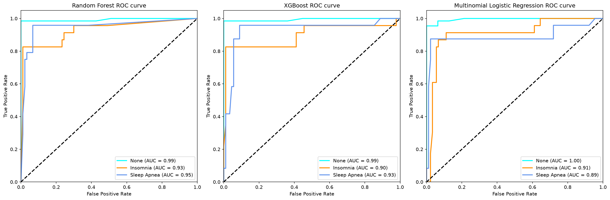
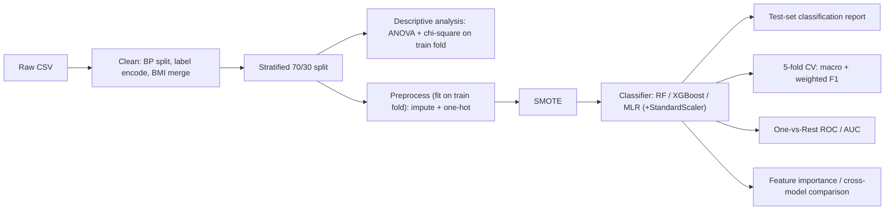
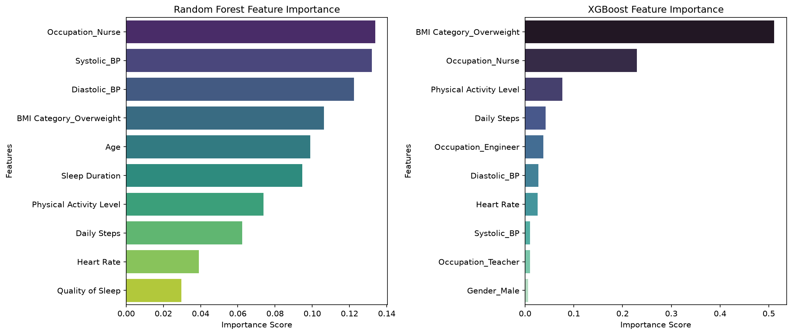

# Sleep Disorder Prediction

[](https://github.com/<github-username>/sleep-disorder-prediction/actions/workflows/tests.yml)


A reproducible machine learning pipeline that predicts **sleep disorder risk (None / Insomnia / Sleep Apnea)** from lifestyle and physiological data, benchmarking Random Forest, XGBoost, and Multinomial Logistic Regression under class imbalance.



## Why This Project

Sleep disorders are common and frequently under-diagnosed, yet they correlate with signals routinely captured by wearables and health screenings — sleep duration, stress, blood pressure, heart rate, occupation. This project tests whether those signals are sufficient to flag Insomnia or Sleep Apnea risk, and identifies which features drive that signal consistently across independent model families — the kind of triage signal that could inform low-cost, early screening tools.

Beyond the modeling question, the project is built as a **production-style pipeline**, not a one-off analysis script: every preprocessing step that fits parameters from data is scoped to the training fold only, evaluation metrics are chosen to match what the training objective actually optimizes for, and every stage is unit-tested, typed, linted, and CI-gated.

## Highlights

- **Preprocessing fit on the training fold only** — imputation and one-hot encoding are fit inside each model pipeline, never on the full dataset; the test set is touched exactly once, for final scoring.
- **Imbalance handled and verified, not assumed** — SMOTE is applied per-fold via `imblearn.Pipeline`; a redundant `class_weight="balanced"` was identified and removed after confirming it had zero effect once SMOTE already balances the fold.
- **Evaluation metric chosen to match the training objective** — macro F1 (not the more commonly reported weighted F1) is the primary metric, because weighted F1 is dominated by the majority class and can mask exactly the minority-class gains SMOTE is meant to produce.
- **Fully reproducible CLI pipeline** — `python -m sleep_disorder.main` regenerates every table, figure, and model from raw data in under a minute.
- **Inference-ready** — a trained pipeline can score a new record via CLI (`sleep_disorder.inference`) without touching training code.
- **Engineering hygiene**: 25 pytest unit tests, `ruff` linting, full `mypy` type coverage, GitHub Actions CI, structured logging, dataclass-based configuration.

## Dataset

[Sleep Health and Lifestyle Dataset](https://www.kaggle.com/datasets/uom190346a/sleep-health-and-lifestyle-dataset) (Kaggle, public). 374 individuals, 13 raw features — demographics, sleep metrics, activity, stress, blood pressure, heart rate. Target distribution: **None 58.6% · Sleep Apnea 20.9% · Insomnia 20.6%** (moderate imbalance). Full column dictionary in [`data/README.md`](data/README.md).

## Approach

**Models.** Random Forest, XGBoost, and Multinomial Logistic Regression, each wrapped in an identical `imblearn.Pipeline`: `impute/encode → SMOTE → [scale, for MLR] → classifier`. Fixed hyperparameters (see `config.py`) keep the comparison a clean baseline rather than a leaderboard chase.

**Preprocessing.** Blood pressure is decomposed into systolic/diastolic components; the raw data's two "normal BMI" labels are merged into one to stop the one-hot encoding from being fragmented. All stateful transforms (imputation, one-hot encoding) are fit only inside each fold's training split.

**Class imbalance.** SMOTE oversampling is applied per-fold, never to a held-out split. `class_weight="balanced"` was tested and dropped: once SMOTE already equalizes class counts within a fold, it computes a uniform weight of 1 and does nothing — the code shouldn't imply two imbalance-correction techniques are stacking when only one is active.

**Evaluation.** 5-fold stratified CV and a held-out 30% test set, both scored on macro F1 (primary) and weighted F1 (secondary, for comparison with more commonly reported baselines), plus One-vs-Rest ROC/AUC and per-model feature importance.

**Statistical rigor.** ANOVA (numeric features) and chi-square (categorical features) run on the training split only — no code path touches the test set before final evaluation. Chi-square results are automatically flagged when a category's expected cell frequency falls below the test's validity threshold, rather than reporting an unreliable p-value at face value.



## Results

| Model | CV Macro F1 | CV Weighted F1 | Test Macro F1 | Test Weighted F1 | Test Accuracy | Macro AUC |
|---|---|---|---|---|---|---|
| Random Forest | 0.875 ± 0.033 | 0.896 ± 0.026 | 0.832 | 0.881 | 0.876 | **0.956** |
| XGBoost | 0.872 ± 0.034 | 0.892 ± 0.028 | **0.867** | **0.905** | **0.903** | 0.940 |
| Multinomial Logistic Regression | 0.865 ± 0.043 | 0.885 ± 0.037 | 0.856 | 0.889 | 0.885 | 0.931 |

All three models generalize similarly under cross-validation. XGBoost wins on held-out test performance; Random Forest has the highest AUC and the tightest CV variance. Full reports in `outputs/tables/`.

**Feature importance.** Ranked by Random Forest and XGBoost importance and mean absolute Multinomial Logistic Regression coefficient, five features land in **all three models'** top 10 — a cross-model agreement computed directly in code, not eyeballed:

`Diastolic_BP` · `Systolic_BP` · `Occupation_Nurse` · `Daily Steps` · `Heart Rate`

Blood pressure and heart rate track the known clinical association between sleep apnea and cardiovascular strain; `Occupation_Nurse` reflects shift-work-driven sleep disruption in this sample.



## Quickstart

```bash
git clone <this-repo>
cd sleep-disorder-prediction
python -m venv .venv && source .venv/bin/activate   # Windows: .venv\Scripts\activate
pip install -e ".[dev]"

python -m sleep_disorder.main                        # run the full pipeline
pytest tests/                                          # 25 unit tests
```

Score a new record with a trained model:

```bash
python -m sleep_disorder.inference --model random_forest --input examples/sample_record.json
```

```json
{"prediction": "Sleep Apnea", "probabilities": {"None": 0.03, "Insomnia": 0.45, "Sleep Apnea": 0.52}}
```

**Requirements:** Python ≥ 3.10 · pandas · scikit-learn · imbalanced-learn · xgboost · scipy · matplotlib · seaborn · joblib. Full list in [`pyproject.toml`](pyproject.toml).

## Engineering Practices

- **Testing** — 25 pytest unit tests covering preprocessing, model registry construction, evaluation metrics, and inference, run automatically in CI.
- **Static analysis** — `ruff` (lint) and `mypy` (types) both clean across all 12 source modules; every public function is fully type-hinted.
- **Config-driven design** — paths, random seeds, column schema, and model hyperparameters live in one `config.py`; model hyperparameter groups use `@dataclass(frozen=True)` where that genuinely models structured, related settings — not applied indiscriminately.
- **CI/CD** — GitHub Actions runs lint, type-check, and tests on every push and pull request.
- **Structured logging** — leveled logging (`debug`/`info`/`warning`/`exception`) configured once at each CLI entry point, not hardcoded into library code.
- **API safety** — evaluation functions that touch both train and test data use keyword-only arguments to eliminate accidental train/test parameter swaps.
- **Single responsibility per module** — each pipeline stage (load, clean, describe, train, evaluate, explain, infer) is an independently testable, independently importable module.

## Project Structure

```
.
├── .github/workflows/tests.yml     # CI: ruff + mypy + pytest on every push/PR
├── data/
│   ├── raw/                 # Source dataset, version-controlled
│   ├── processed/           # Pipeline output (gitignored, regenerable)
│   └── README.md            # Data dictionary
├── docs/images/               # Figures embedded in this README
├── examples/
│   └── sample_record.json     # Example input for the inference CLI
├── outputs/
│   ├── figures/               # Boxplots, ROC curves, feature importance plots
│   ├── tables/                 # Descriptive stats, classification reports, model comparison
│   └── models/                  # Trained pipelines (joblib)
├── src/sleep_disorder/
│   ├── config.py               # Paths, random seed, column schema, model hyperparameters
│   ├── utils.py                 # Logging, figure/table/JSON saving helpers
│   ├── data_loader.py           # Read raw CSV
│   ├── preprocessing.py         # Deterministic data cleaning
│   ├── descriptive_analysis.py  # ANOVA / chi-square statistical analysis
│   ├── models.py                 # Model registry: RF / XGBoost / MLR pipelines
│   ├── train.py                   # Train/test split, fit, persist
│   ├── evaluate.py                # Classification report, 5-fold CV, ROC/AUC
│   ├── feature_importance.py      # Importance/coefficients + cross-model comparison
│   ├── inference.py                # Load a saved pipeline and score one new record
│   └── main.py                      # CLI orchestration
├── tests/                            # pytest unit tests (25 tests)
└── pyproject.toml
```

## Limitations & Future Work

- **Sample size** — 374 rows is small for a 3-class problem; test-set metrics carry wide confidence intervals.
- **Sparse categories** — several `Occupation` levels have fewer than 5 samples; affected chi-square results are flagged rather than trusted at face value.
- **No hyperparameter tuning** — all three models use fixed, documented defaults to keep this a clean baseline; `GridSearchCV`/`Optuna` tuning is a natural next step, reported as a delta over this baseline.
- **Probability calibration** — SMOTE-trained classifiers' predicted probabilities aren't guaranteed to be well-calibrated; `CalibratedClassifierCV` and calibration curves would quantify this.
- **Deployment** — `inference.py` is a CLI; wrapping it in a lightweight FastAPI service would demonstrate a full serving path.
- **External validation** — testing whether the cross-model feature agreement holds on a second, independent sleep-health dataset.

## References

- Dataset: [Sleep Health and Lifestyle Dataset](https://www.kaggle.com/datasets/uom190346a/sleep-health-and-lifestyle-dataset), Kaggle.
- Lemaître, G., Nogueira, F., & Aridas, C. K. (2017). [imbalanced-learn: A Python Toolbox to Tackle the Curse of Imbalanced Datasets](https://jmlr.org/papers/v18/16-365.html). *JMLR*.
- Chen, T., & Guestrin, C. (2016). [XGBoost: A Scalable Tree Boosting System](https://doi.org/10.1145/2939672.2939785). *KDD*.
- Pedregosa et al. (2011). [Scikit-learn: Machine Learning in Python](https://jmlr.org/papers/v12/pedregosa11a.html). *JMLR*.

## License

[MIT](LICENSE)
